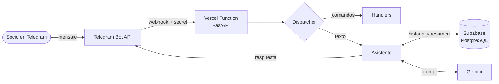

# 🤖 Rody — Asistente Virtual de Rotaract Club Arrecifes

[](https://github.com/AleSklate0807/rody-bot-rtcArrecifes/actions/workflows/ci.yml)


[](LICENSE)

> Bot de Telegram con IA para el asistente institucional de Rotaract Club Arrecifes, Argentina.  
> Construido con Python · Vercel · Supabase · pgvector · Gemini Flash

---

## ¿Qué es Rody?

Rody es un asistente virtual disponible 24/7 vía Telegram que permite a los socios de Rotaract Club Arrecifes:

- 🧠 **Consultar documentación institucional** (estatutos, reglamentos, manuales) mediante RAG
- 💬 **Mantener conversaciones con memoria** — cada socio tiene su propio historial
- 🏛️ **Conocer el club** — autoridades, proyectos, eventos
- ✍️ **Asistencia operativa** — redacción de actas, planificación de proyectos

## Stack tecnológico

| Componente | Tecnología | Rol |
|---|---|---|
| **Interfaz** | Telegram Bot API | Canal de comunicación |
| **Backend** | Python 3.13 + FastAPI | Lógica del asistente |
| **Hosting** | Vercel Hobby (Serverless) | Webhook handler |
| **Base de datos** | Supabase Free (PostgreSQL) | Persistencia + pgvector |
| **IA** | Gemini 3.5 Flash (`google-genai`) | Generación de respuestas |
| **Embeddings** | gemini-embedding-001 | Búsqueda semántica (RAG) |

**Costo de infraestructura: USD 0**

## Estructura del proyecto

```
rody-bot-rtcArrecifes/
├── api/
│   └── webhook.py          # Entry point de Vercel (webhook + health)
├── app/
│   ├── bot/                # Dispatcher y handlers de Telegram
│   ├── core/               # Orquestador, memoria y prompt builder
│   ├── models/             # Modelos Pydantic
│   ├── services/           # Clientes de Supabase, Gemini y Telegram
│   └── config/             # Configuración y variables de entorno
├── database/
│   └── migrations/         # Scripts SQL de Supabase
├── scripts/                # Herramientas de administración (webhook, ingesta de PDFs)
├── tests/                  # Tests (pytest)
└── .github/workflows/      # GitHub Actions (keep-alive y limpieza de Supabase)
```

## Arquitectura



**Flujo de un mensaje:**

1. Telegram envía el update al webhook; se valida el header `X-Telegram-Bot-Api-Secret-Token`.
2. Se descartan updates duplicados (idempotencia por `update_id`).
3. Se identifica al socio y se verifica que esté habilitado.
4. Se arma el prompt: instrucciones de Rody + resumen acumulado + últimos turnos.
5. Gemini genera la respuesta, que se sanitiza para el HTML de Telegram y se envía.
6. El turno se guarda; cada 15 turnos la conversación se resume y se rota.

**Decisiones de diseño:**

- **Serverless sin estado:** todo el estado vive en Supabase, así que cada invocación es independiente.
- **Seguridad:** RLS activo en todas las tablas; solo el backend (service role) accede a los datos.
- **Acceso por aprobación:** evita que terceros consuman la cuota de la IA.
- **Costo cero:** todos los servicios usan su plan gratuito.

## Setup inicial

### 1. Clonar el repositorio

```bash
git clone https://github.com/AleSklate0807/rody-bot-rtcArrecifes.git
cd rody-bot-rtcArrecifes
```

### 2. Crear entorno virtual e instalar dependencias

```bash
python -m venv .venv
.venv\Scripts\activate        # Windows
# source .venv/bin/activate   # Linux/Mac

pip install -r requirements-dev.txt
```

### 3. Configurar variables de entorno

```bash
cp .env.example .env
# Editar .env con tus credenciales reales
```

### 4. Configurar base de datos

Ejecutar las migraciones **en orden** en el SQL Editor de Supabase:

```
database/migrations/001_initial_schema.sql
database/migrations/002_security_and_access.sql
```

### 5. Desplegar en Vercel

```bash
npm install -g vercel
vercel --prod
```

### 6. Registrar el webhook de Telegram

```bash
python scripts/set_webhook.py https://tu-proyecto.vercel.app
```

### 7. Correr los tests

```bash
pytest
```

## Variables de entorno requeridas

| Variable | Descripción | Dónde obtenerla |
|---|---|---|
| `TELEGRAM_BOT_TOKEN` | Token del bot | [@BotFather](https://t.me/BotFather) |
| `TELEGRAM_WEBHOOK_SECRET` | Cadena aleatoria para validar requests | Generarla localmente |
| `SUPABASE_URL` | URL del proyecto Supabase | Supabase Dashboard → Settings → API |
| `SUPABASE_SERVICE_KEY` | Service role key de Supabase | Supabase Dashboard → Settings → API |
| `GEMINI_API_KEY` | API key de Google AI Studio | [aistudio.google.com](https://aistudio.google.com/app/apikey) |
| `GEMINI_MODEL` | Modelo de Gemini (default `gemini-3.5-flash`) | Opcional |
| `ADMIN_TELEGRAM_IDS` | IDs de Telegram de los admins, separados por coma | [@userinfobot](https://t.me/userinfobot) |
| `ACCESO_ABIERTO` | `true` para no requerir aprobación (default `false`) | Opcional |

## Control de acceso

Los socios nuevos quedan **pendientes de aprobación**: el bot les responde con su ID
y avisa a los admins. Comandos de admin:

- `/pendientes` — ver pedidos de acceso
- `/aprobar <telegram_id>` — habilitar a un socio
- `/bloquear <telegram_id>` — deshabilitar a un socio

## Fases de desarrollo

- [ ] **Fase 1:** MVP conversacional con memoria individual por socio *(código listo, falta desplegar)*
- [ ] **Fase 2:** RAG con documentación institucional (PDFs)
- [ ] **Fase 3:** Datos del club (socios, proyectos, eventos)
- [ ] **Fase 4:** Asistente operativo (actas, planificación)

## Licencia

Distribuido bajo licencia [MIT](LICENSE). Proyecto sin fines de lucro de Rotaract Club Arrecifes, Argentina.

